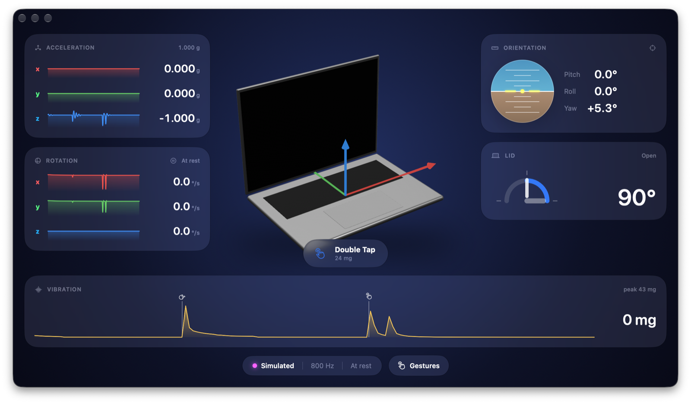

# gyro

[](https://github.com/nathanielnoyd/gyro-mac/actions/workflows/ci.yml)
[](LICENSE)


Read the accelerometer, gyroscope and lid angle sensor hidden inside Apple Silicon MacBooks.

Apple doesn't offer a public API for these sensors. They sit behind the
**Sensor Processing Unit (SPU)**, the always-on coprocessor that also handles
lid and ambient-light sensing. `gyro` talks to them directly through IOKit.

```
  gyro  Mac17,9                                  ● Live  ·  800 Hz  ·  At rest
 ╭─ Acceleration ─────────── 1.000 g ─╮ ╭─ Orientation ─────── z zeroes yaw ─╮
 │ x  ⠒⠒⠢⠤⣄⣀                  0.000 g │ │                                    │
 │         ⠈⠉⠓⠲⠤⠤⠖⠋⠉⠉⠉⠉⠉⠉             │ │                    Pitch      0.0° │
 │ y    ⢀⣠⠴⠒⠒⠒⠒⠦⣄             0.000 g │ │                                    │
 │    ⠤⠚⠉       ⠈⠙⠒⠒⠒⠒⠒⠒⠒             │ │ ▄▄▄▄▄▄▄▄▄▄▄▄▄▄     Roll       0.0° │
 │ z     ⢀⣠⠴⠒⠒⠢⢄             -1.000 g │ │ ██████████████                     │
 │    ⠉⠓⠊⠉      ⠑⠒⠒⠒⠒⠲⠶⠖⠒             │ │  ▀██████████▀      Yaw       +5.3° │
 ╰────────────────────────────────────╯ │    ▀▀▀▀▀▀▀▀                        │
 ╭─ Rotation ───────────── ◦ At rest ─╮ ╰────────────────────────────────────╯
 │ x         ⢀⣀⡰⠒⢄            0.0 °/s │ ╭─ Lid ─────────────────────── Open ─╮
 │    ⠤⠤⠤⠤⠔⠒⠋⠉    ⠉⠉⠉⠉⠉⠉⠉             │ │         ⡀⡀⣀⡀                       │
 │ y            ⡴⠲⡄           0.0 °/s │ │     ⠄⠂⠁⠁ ⢠⠂⠉⠙⠢⣄          █▀█ ▀▀█ ° │
 │    ⠒⠒⠲⠤⠤⠤⠤⠤⠤⠼⠁ ⠉⠉⠉⠉⠉⠉⠉             │ │   ⡐⠈     ⢸    ⠈⠳⡀        █▀█  ▀█   │
 │ z                          0.0 °/s │ │  ⢐       ⡜      ⢹⡀       ▀▀▀ ▀▀▀   │
 │    ⠉⠉⠉⠉⠉⠉⠉⠉⠉⠉⠉⠉⠉⠉⠉⠉⠉⠉⠉             │ │  ⡂       ⣇⣀⣀⣀⣀⣀⣀ ⡇                 │
 ╰────────────────────────────────────╯ ╰────────────────────────────────────╯
 ╭─ Vibration ─────────────────────────────────────────────────── peak 35 mg ─╮
 │                                                      ◂⣶                    │
 │                                                       ⣿               0 mg │
 │ ⢀⣀⣀⣀⣀⡀⣀⣀⣀⣀⣀⣀⣀⣀⣀⣀⣀⣀⣀⣀⣀⣀⣀⣀⣀⣀⣀⣀⣀⣀⣀⣀⣀⣀⣀⣀⣀⣀⣀⣀⣀⣀⣀⣀⣀⣀⣀⣀⣀⣀⣀⣀⣀⣀⣿⣷⣦⡄⣤⣄⣀⢀⣀⣀⢀          │
 ╰────────────────────────────────────────────────────────────────────────────╯
  ◂ Tap Left  24 mg                          space pause   z zero yaw   q quit
```

## Requirements

- An Apple Silicon MacBook (tested on an M5 Pro MacBook Pro)
- macOS 26 or later
- Swift 6.2 or later (Xcode 26+)

## Install

Download `gyro` from the [latest release](https://github.com/nathanielnoyd/gyro-mac/releases/latest),
or build it from source:

```bash
git clone https://github.com/nathanielnoyd/gyro-mac.git
cd gyro-mac
swift build -c release
sudo install -d /usr/local/bin
sudo install .build/release/gyro /usr/local/bin/
```

## Usage

```bash
sudo gyro                      # live dashboard of every sensor
sudo gyro stream               # print readings as a table
sudo gyro stream -f csv -d 10 > motion.csv
sudo gyro stream -f json | jq .attitude
sudo gyro events -v            # recognize taps and typing, with their features
sudo gyro calibrate            # walk through each gesture and fit them to your Mac
gyro events --replay taps.csv  # replay a recording through the detector, no sudo needed
gyro lid --watch               # lid angle, no sudo needed
gyro sensors                   # list what this Mac has
```

The accelerometer and gyroscope only report to processes running as root.
Without `sudo`, the dashboard still shows the lid angle.

The dashboard has the same instruments as the app: a trace of each axis, an artificial
horizon, the lid angle and a seismograph that marks each gesture it recognizes. It fits
itself to the terminal window, uses 24-bit color where the terminal supports it, and
respects [`NO_COLOR`](https://no-color.org). Press space to pause, z to zero the yaw
and q to quit.

## The app



`App/Gyro.xcodeproj` builds **Gyro**, a SwiftUI app with a live 3D model, charts, an
artificial horizon and a menu bar level. Because the IMU only reports to root, the app
bundles a small helper daemon (`gyro-helper`) that it installs with `SMAppService`. You
approve it once in System Settings › General › Login Items, and it streams readings to
the app over XPC. The helper exits after 30 seconds without clients; launchd starts it
again on demand.

Open the project in Xcode 26 or later and run the **Gyro** scheme. It signs ad hoc by
default. That works, but macOS pins the helper to the exact binary it first approved,
so after changing helper code it won't start. Signing with a Team ID avoids this; see
`App/Config/Base.xcconfig`.

When the app can't reach its helper, it registers it again on its own. If that isn't
enough, it offers **Repair Helper**, which asks for an administrator password to unload
the stale helper (what `scripts/reset-helper.sh` does) and registers it again. Rarely,
macOS loses track of which copy of the app a helper belongs to, usually after builds
are moved or deleted, and refuses to start or replace it. Only resetting its list of
background items clears that: run `sudo sfltool resetbtm`, restart, and install the
helper again. This also asks you to approve other apps' background items again.

Because the motion sensors can reveal what you type, the helper only streams to the
Gyro app. A team-signed helper checks that the app comes from the same team. An ad hoc
helper has no team to check, so it only accepts the exact app it was shipped inside.

## Gestures

Each gesture can play a sound, show a notification, run a shortcut, open a URL or run
a shell script (with `$GYRO_GESTURE`, `$GYRO_GESTURE_ID`, `$GYRO_TAPS` and `$GYRO_STRENGTH_MG` set). Every
recognition is also posted as the distributed notification
`io.github.nathanielnoyd.gyro.gesture`.

Gestures are saved in `~/Library/Application Support/Gyro`, along with each calibration
(`Calibrations/`) and the raw readings behind every set of examples (`Recordings/`), in
the CSV format `gyro events --replay` reads.

## How it works

Each SPU sensor is an `AppleSPUHIDDevice` in the I/O Registry, identified by its HID usage:

| Sensor        | Usage page | Usage | Format                                           |
| ------------- | ---------- | ----- | ------------------------------------------------ |
| Accelerometer | `0xFF00`   | `0x03` | 22-byte input report, x/y/z as 16.16 fixed point, in g |
| Gyroscope     | `0xFF00`   | `0x09` | Same layout, in degrees per second               |
| Lid angle     | `0x0020`   | `0x8A` | Feature report 1, `UInt16` degrees               |
| Ambient light | `0xFF00`   | `0x04` | Not decoded yet                                  |

To start the IMU, `gyro` sets `SensorPropertyReportingState`,
`SensorPropertyPowerState` and `ReportInterval` on the matching
`AppleSPUHIDDriver`. The driver only applies these for root. Readings
then arrive as HID input reports, about 800 per second from each sensor.

Orientation comes from a [Mahony complementary filter](Sources/GyroKit/Fusion/MahonyFilter.swift).
It integrates the gyroscope and uses gravity from the accelerometer to correct drift.
Pitch and roll are absolute. There's no magnetometer, so yaw is relative to where you started. To keep it from drifting, [`GyroBiasEstimator`](Sources/GyroKit/Fusion/GyroBiasEstimator.swift) learns the gyroscope's resting bias whenever the Mac sits still, and orientation holds steady while it does. Press `z` in the dashboard, or ⌘0 in the app, to re-zero yaw.


## Using GyroKit in your own code

The sensor code lives in a separate library you can use:

```swift
import GyroKit

let angle = try LidAngleSensor().angle()

var tracker = MotionTracker()
for await sample in try MotionSensor().samples() {   // requires root
    tracker.process(sample)
    print(tracker.snapshot.attitude)
}
```

## Project layout

```
Sources/GyroKit/     Sensor access, report decoding and sensor fusion
  IOKit/             Thin wrappers over IOHIDDevice and the I/O Registry
  Sensors/           MotionSensor, LidAngleSensor, SPUSensor
  Fusion/            MahonyFilter, GyroBiasEstimator, MotionTracker
  Events/            MotionEventDetector, GestureSignature, GestureRecognizer, presets
  Math/              Vector3, Quaternion, Attitude
Sources/GyroXPC/     The XPC interface between the app and its helper
Sources/gyro/        The command-line tool
  Commands/          One file per subcommand
  Dashboard/         The live dashboard's feed, layout and instruments
  Terminal/          Drawing, styling and input for the terminal
Tests/GyroKitTests/  Unit tests for decoding, fusion, math and event detection
Tests/GyroXPCTests/  Tests that the app and helper agree on their protocol
App/                 The Gyro app (Gyro/) and its privileged helper (GyroHelper/)
scripts/             Development scripts
docs/                Images for this README
```

## Caveats

These are undocumented interfaces discovered through reverse engineering.
They may change or disappear in any macOS update. Use at your own risk.
To report a security problem, see [SECURITY.md](SECURITY.md).

## Credits

- [olvvier/apple-silicon-accelerometer](https://github.com/olvvier/apple-silicon-accelerometer) for the SPU IMU report format.
- [samhenrigold/LidAngleSensor](https://github.com/samhenrigold/LidAngleSensor) for the lid angle sensor.

## License

[MIT](LICENSE)
